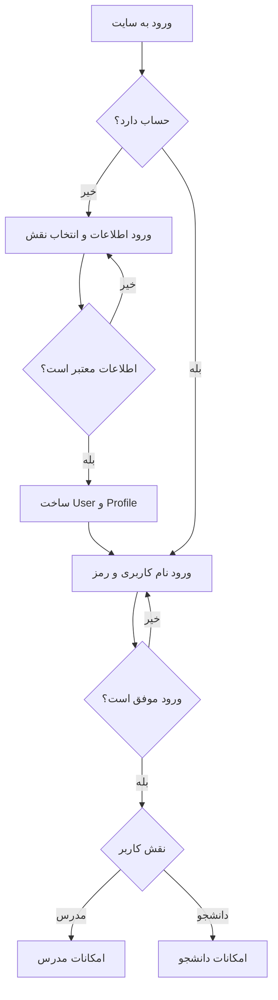
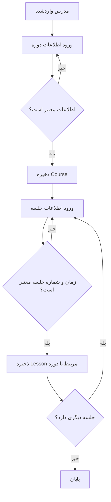
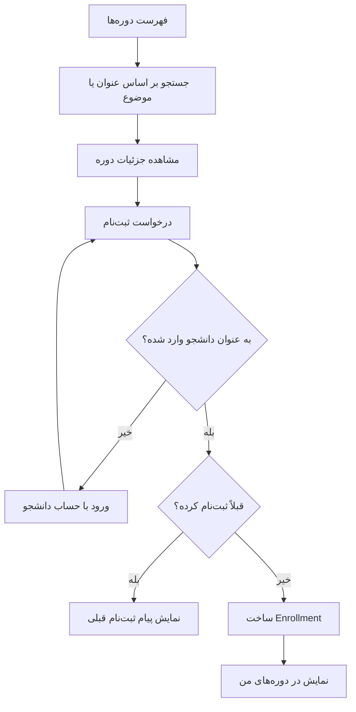
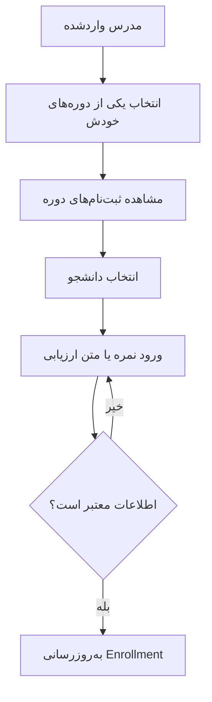
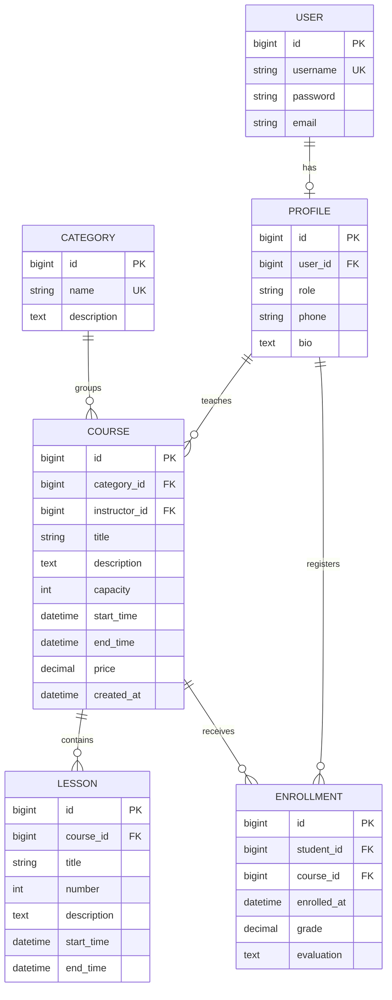

# گزارش فاز اول: سامانه مدیریت دوره‌های آموزشی

## ۱. محدوده فاز اول

طبق بخش ۲.۱ فایل توضیحات پروژه، در این فاز باید وب‌اپلیکیشن‌ها تعریف شوند، فرایندها طراحی شوند و مدل‌ها مشخص و پیاده‌سازی شوند. موضوع انتخابی، «مدیریت دوره‌های آموزشی» در بخش ۳.۸ است.

مدرس دوره و جلسه تعریف می‌کند، دانشجو دوره‌ها را پیدا می‌کند و در آن‌ها ثبت‌نام می‌کند و مدرس برای دانشجوی ثبت‌نام‌شده نمره یا ارزیابی می‌نویسد. در این فاز ساختار داده و طراحی این کارها آماده شده است. نمودارها رفتار موردنظر سایت در فازهای بعد را نشان می‌دهند؛ این مسیرها هنوز صفحه و فرم عمومی ندارند.

## ۲. وب‌اپلیکیشن‌ها

| اپ | مسئولیت | مدل‌ها |
| --- | --- | --- |
| `accounts` | اطلاعات تکمیلی کاربر و تشخیص مدرس یا دانشجو | `Profile` و ارتباط با `User` آماده Django |
| `courses` | موضوع‌ها، دوره‌ها و جلسه‌های هر دوره | `Category`، `Course`، `Lesson` |
| `enrollments` | ارتباط دانشجو با دوره و نگهداری نمره و ارزیابی | `Enrollment` |

مدل `User` آماده Django اطلاعات نام کاربری، نام، نام خانوادگی، ایمیل و رمز هش‌شده را نگه می‌دارد. برای تکرار نکردن این اطلاعات، فقط نقش، شماره تماس و توضیحات کاربر در `Profile` قرار گرفته است. هر کاربر حداکثر یک پروفایل دارد. فرض ساده این پروژه این است که هر پروفایل فقط یک نقش دارد.

## ۳. طراحی فرایندها

### ۳.۱. ساخت حساب و ورود — accounts

1. کاربر فرم ثبت‌نام را پر می‌کند و نقش خود را مشخص می‌کند.
2. اطلاعات بررسی می‌شوند؛ نام کاربری نباید تکراری باشد.
3. حساب `User` و پروفایل مربوط به آن ساخته می‌شوند.
4. کاربر با نام کاربری و رمز عبور وارد می‌شود.
5. امکانات مربوط به نقش او نمایش داده می‌شوند.

ساخت فرم‌ها و صفحه ورود در فاز دوم است. مدیریت سفارشی session و cookie و تأیید ایمیل هم طبق فایل پروژه به فازهای بعد تعلق دارند. فعلاً حساب و پروفایل از ادمین جداگانه ساخته می‌شوند.

### ۳.۲. تعریف دوره و جلسه — courses

1. مدرس وارد حساب خود می‌شود.
2. عنوان، موضوع، توضیحات، ظرفیت، زمان شروع و پایان و هزینه دوره را وارد می‌کند.
3. اطلاعات بررسی و دوره با شناسه همان مدرس ذخیره می‌شود.
4. مدرس برای دوره، جلسه‌هایی شامل عنوان، شماره، توضیحات و زمان شروع و پایان تعریف می‌کند.
5. هر جلسه به یک دوره تعلق دارد و شماره جلسه در آن دوره تکراری نیست.

### ۳.۳. جستجو و ثبت‌نام در دوره — courses و enrollments

1. دانشجو فهرست دوره‌ها را می‌بیند.
2. در صورت نیاز، بر اساس عنوان یا موضوع جستجو می‌کند.
3. جزئیات یک دوره را باز می‌کند.
4. پس از ورود، درخواست ثبت‌نام می‌دهد.
5. سیستم نقش دانشجو و تکراری نبودن ثبت‌نام را بررسی می‌کند.
6. یک `Enrollment` با زمان ثبت‌نام ساخته می‌شود و دوره در فهرست دوره‌های دانشجو قرار می‌گیرد.

فیلد ظرفیت برای طراحی مدل لازم است؛ جلوگیری از پر شدن بیش از ظرفیت، در فایل پروژه قابلیت امتیازی است و فعلاً پیاده‌سازی نشده است. هزینه فقط نگهداری می‌شود و درگاه پرداخت بخشی از این فاز نیست.

### ۳.۴. مشاهده دانشجویان و ارزیابی — enrollments

1. مدرس یکی از دوره‌های خودش را انتخاب می‌کند.
2. ثبت‌نام‌های همان دوره نمایش داده می‌شوند.
3. مدرس یک دانشجو را انتخاب می‌کند.
4. نمره بین صفر تا بیست یا متن ارزیابی را وارد می‌کند.
5. اطلاعات در رکورد ثبت‌نام همان دانشجو ذخیره می‌شود.

بررسی مالکیت دوره و محدود کردن عملیات کاربران در viewهای فازهای بعد انجام می‌شود. پنل فعلی فقط برای مدیر سایت است و داشبورد مدرس یا دانشجو محسوب نمی‌شود.

## ۴. طراحی مدل‌ها

کلید اصلی `id` برای هر مدل به صورت خودکار توسط Django ساخته می‌شود.

### Profile — پروفایل

| فیلد | نوع | توضیح |
| --- | --- | --- |
| `user` | OneToOneField به User | هر حساب حداکثر یک پروفایل |
| `role` | CharField با choices | `instructor` یا `student`، پیش‌فرض دانشجو |
| `phone` | CharField | شماره تماس اختیاری |
| `bio` | TextField | توضیحات اختیاری |

### Category — موضوع

| فیلد | نوع | توضیح |
| --- | --- | --- |
| `name` | CharField | نام یکتای موضوع، مثلاً برنامه‌نویسی |
| `description` | TextField | توضیحات اختیاری |

موضوع مدل جداگانه دارد تا نام آن در دوره‌های مختلف یکسان باشد و جستجو بر اساس موضوع در فاز دوم ساده شود.

### Course — دوره

| فیلد | نوع | توضیح |
| --- | --- | --- |
| `title` | CharField | عنوان دوره |
| `description` | TextField | توضیحات دوره |
| `category` | ForeignKey به Category | موضوع دوره |
| `instructor` | ForeignKey به Profile | پروفایل مدرس دوره |
| `capacity` | PositiveIntegerField | ظرفیت حداقل یک نفر |
| `start_time` و `end_time` | DateTimeField | شروع و پایان دوره |
| `price` | DecimalField | هزینه نامنفی به تومان؛ صفر یعنی رایگان |
| `created_at` | DateTimeField | زمان ایجاد به صورت خودکار |

### Lesson — جلسه

| فیلد | نوع | توضیح |
| --- | --- | --- |
| `course` | ForeignKey به Course | دوره مربوط به جلسه |
| `title` | CharField | عنوان جلسه |
| `number` | PositiveIntegerField | شماره جلسه از یک |
| `description` | TextField | توضیحات اختیاری |
| `start_time` و `end_time` | DateTimeField | شروع و پایان جلسه |

ترکیب `course` و `number` یکتا است. جلسه‌های دو دوره متفاوت می‌توانند شماره یکسان داشته باشند.

### Enrollment — ثبت‌نام و ارزیابی

| فیلد | نوع | توضیح |
| --- | --- | --- |
| `student` | ForeignKey به Profile | پروفایل دانشجو |
| `course` | ForeignKey به Course | دوره انتخاب‌شده |
| `enrolled_at` | DateTimeField | زمان ثبت‌نام به صورت خودکار |
| `grade` | DecimalField | نمره اختیاری از صفر تا بیست |
| `evaluation` | TextField | متن ارزیابی اختیاری مدرس |

ترکیب `student` و `course` یکتا است تا ثبت‌نام تکراری ساخته نشود. نمره روی ثبت‌نام ذخیره می‌شود، چون مربوط به یک دانشجوی مشخص در یک دوره مشخص است. برای ساده ماندن طرح، مدل جداگانه ارزیابی نداریم. نمره خالی با نمره صفر تفاوت دارد.

## ۵. روابط مدل‌ها

- هر مدرس می‌تواند چند دوره داشته باشد و هر دوره فقط یک مدرس دارد.
- هر موضوع می‌تواند چند دوره داشته باشد و هر دوره یک موضوع دارد.
- هر دوره می‌تواند چند جلسه داشته باشد و هر جلسه فقط مربوط به یک دوره است.
- رابطه دانشجو و دوره چندبه‌چند است و از طریق `Enrollment` نگهداری می‌شود؛ چون این رابطه زمان ثبت‌نام و نمره هم دارد.
- اگر دوره حذف شود، جلسه‌ها و ثبت‌نام‌های آن با `CASCADE` حذف می‌شوند.
- موضوع یا پروفایل مدرسی که دوره دارد و پروفایل دانشجویی که ثبت‌نام دارد، با `PROTECT` از حذف محافظت می‌شوند.
- با حذف User، پروفایلش هم حذف می‌شود؛ اگر پروفایل رابطه محافظت‌شده داشته باشد، حذف کاربر نیز متوقف می‌شود.

## ۶. قواعد و فرض‌ها

- هر پروفایل یک نقش دارد. تغییر نقش پروفایل دارای دوره یا ثبت‌نام در این فاز مدیریت نشده است؛ نقش چنین پروفایلی را در ادمین تغییر ندهید.
- `limit_choices_to` انتخاب مدرس دوره و دانشجوی ثبت‌نام را در ادمین و اعتبارسنجی مدل به نقش درست محدود می‌کند؛ این گزینه جای کنترل دسترسی صفحه‌های سایت را نمی‌گیرد.
- ظرفیت و شماره جلسه حداقل یک و هزینه نامنفی هستند.
- زمان پایان دوره و جلسه باید بعد از زمان شروع باشد.
- نمره یا خالی است یا از صفر تا بیست، با حداکثر دو رقم اعشار.
- اعتبارسنجی فیلدها و متد `clean` با `full_clean()` اجرا می‌شوند. ادمین این بررسی را انجام می‌دهد؛ در استفاده مستقیم از ORM باید قبل از ذخیره آن را فراخوانی کرد. این قواعد همگی محدودیت SQL نیستند.
- یکتایی موضوع، پروفایل کاربر، شماره جلسه در هر دوره و ثبت‌نام دانشجو در هر دوره در PostgreSQL نیز اعمال می‌شود.
- زمان‌ها با timezone ذخیره می‌شوند و در ادمین با منطقه زمانی تهران نمایش داده می‌شوند.
- بررسی هم‌پوشانی جلسه‌ها، قرار گرفتن جلسه در بازه زمانی دوره، ظرفیت باقی‌مانده، لغو ثبت‌نام، پرداخت و امکانات امتیازی در این فاز پیاده‌سازی نشده‌اند.

## ۷. نتیجه قابل تحویل

- سه اپ Django و پنج مدل اختصاصی، به همراه مدل آماده User.
- migrationهای اولیه برای ساخت جدول‌ها روی PostgreSQL.
- تعریف فرایندها و نمودار روابط در همین گزارش؛ نمودارهای Mermaid در GitHub قابل نمایش‌اند.
- ثبت مدل‌ها در ادمین برای بررسی دستی.
- راهنمای نصب، اجرا و بکاپ در README.
- بکاپ SQL دیتابیس بدون داده کاربری برای تحویل فاز اول، شامل اطلاعات داخلی Django.

فرم‌ها، viewها، URLهای عمومی و templateهای اختصاصی برای فاز دوم باقی می‌مانند. Manager سفارشی، امکانات session و cookie، log و تأیید ایمیل هم طبق فازبندی فایل پروژه در این تحویل اضافه نشده‌اند. تست‌های خودکار کامل پروژه طبق فایل درس برای فاز چهارم هستند؛ بررسی عملی این تحویل شامل اتصال PostgreSQL، اعمال migrationها، ذخیره و بازیابی روابط، اعتبارسنجی مدل‌ها، بررسی ادمین و بازیابی بکاپ است.
